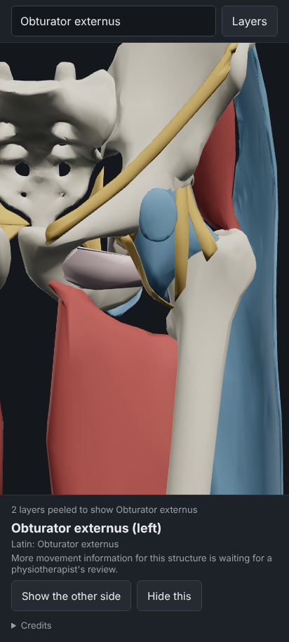
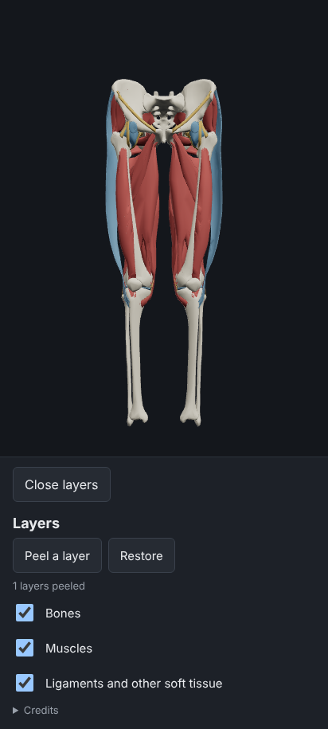
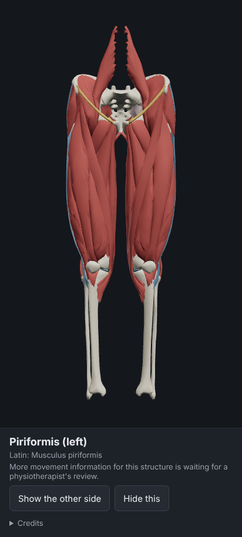
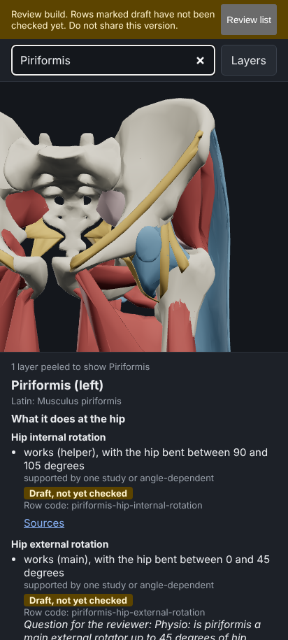

# anatoMe

anatoMe is an educational tool for understanding how the body moves. It is not a diagnostic tool and it is not medical advice. If you have a health concern, please talk to a qualified health professional.

anatoMe is a free, open-source, browser-based 3D anatomy explorer. It starts with the hip, the pelvis and the thigh down to the knee. It is for students, movement teachers, physiotherapists and anyone curious about what lies under the skin and which structures a movement loads.

The link is added when the site is live






## What it does

- **Search** by English or Latin name. Choosing a result selects the structure, turns the camera to it and peels away the layers in front of it.
- **Layers:** hide bones, muscles or the other soft tissue, peel the muscles one layer at a time, or hide a single structure.
- **Info panel:** the name, Latin name and type of the selected structure, where a muscle attaches, and what it does at the hip and the knee, each claim with its sources.
- **Movements:** pick a hip or knee movement or an exercise. Structures are coloured by their role in it, and a slider changes the joint angle. The model itself does not bend.
- **Area:** tap a spot on the model and read which structures lie under it, from the surface inwards, with the movements that load each one. It lists what the model holds and nothing more.
- **Notebook:** log how a movement feels, read your notes in the Notebook tab, print a one-page summary, and save or load a backup file.

## What comes next

More of the body will follow the hip, one region at a time. The movement information will grow as more rows are checked.

## Your notes stay on your device

Notes you write in the Notebook stay in your browser on this device. The app never sends them anywhere and makes no request to another host while you use it. You can save a backup file and load it again, for example on a new phone.

## How the data is checked

Every claim in the app is a row that cites a published source. A row only shows after a person has checked it, a physiotherapist for movement rows and the owner for attachment rows. Unchecked rows never reach the normal build, and a test fails the build if one does. A separate review build shows them as drafts for the checkers, and it is never published. See [docs/deploy-homelab.md](docs/deploy-homelab.md).

## How to run it

You need Node.js 22 or newer.

```bash
npm install
npm run dev                         # starts the viewer, open the address it prints
npm run build                       # writes the finished site to apps/web/dist/
node scripts/check-no-drafts.mjs    # checks that no unchecked row is in apps/web/dist/
npm run build:review -w apps/web    # writes the review copy to apps/web/dist-review/
npm test                            # runs all the tests
npm run validate                    # checks the knowledge base in data/
npm run check-models                # checks the meshes in models/ against data/
```

The end-to-end test opens the built app in a real browser. Run `npm run build` first. The first time, also download the test browser once:

```bash
cd apps/web && npx playwright install chromium && cd ../..
npm run e2e -w apps/web
```

The Python tests for the mesh pipeline need pytest in a local virtual environment:

```bash
python3 -m venv .venv
.venv/bin/pip install pytest
npm run test:py
```

Open the viewer, drag to turn the model and tap a structure to read about it. Add `?perf=1` to the address to see how long the page took to become usable.

The build works from any folder. Copy the contents of `apps/web/dist/` to any web server.

### Rebuilding the models

You only need this to change the meshes. The finished files in `models/` are committed, so the app and the checks work without it. Run these from the repo root:

```bash
bash pipeline/get-blender.sh      # downloads Blender into tools/blender/
bash pipeline/fetch-sources.sh    # downloads BodyParts3D and Z-Anatomy into sources/ and checks them
.venv/bin/python pipeline/assets/bp3d_inventory.py
tools/blender/blender -b --factory-startup -P pipeline/assets/za_inventory_blender.py
tools/blender/blender -b --factory-startup -P pipeline/assets/build_region_blender.py -- \
    --region hip --source bp3d --out models/hip.glb
tools/blender/blender -b --factory-startup -P pipeline/assets/build_region_blender.py -- \
    --region hip --source z-anatomy --out models/hip-z-anatomy.glb
```

Why each mesh comes from the source it does is explained in [docs/phase0/mesh-source-decision.md](docs/phase0/mesh-source-decision.md).

## How to help

Found a wrong or missing claim? Open a "Data correction" issue, see [docs/data-corrections.md](docs/data-corrections.md). Want to add or fix a row, a text or some code? See [CONTRIBUTING.md](CONTRIBUTING.md).

## License

- Code is MIT, see [LICENSE](LICENSE).
- Our own data is CC BY 4.0, see [data/LICENSE](data/LICENSE).
- 3D models are licensed per file, see [models/LICENSE](models/LICENSE).
- Credit texts for all sources are in [ATTRIBUTION.md](ATTRIBUTION.md).
